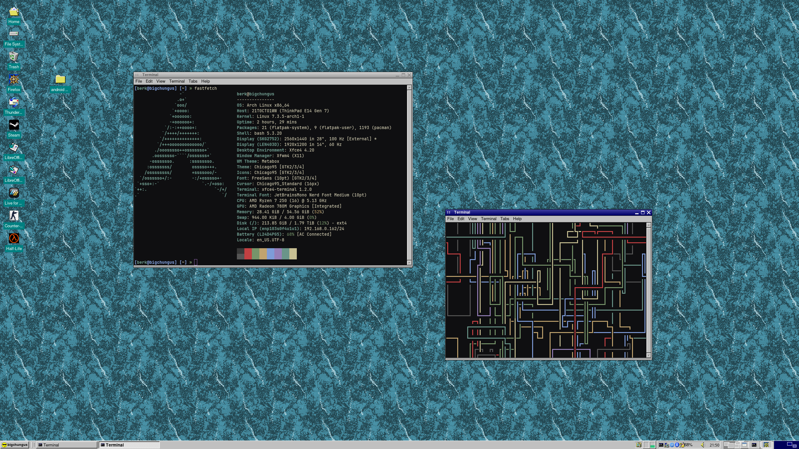

# dotfiles

<p align="center">
  
</p>

<p align="center">
  <em>Arch Linux · Xfce · <a href="https://github.com/grassmunk/Chicago95">Chicago95</a> · Metabox</em>
</p>

Personal configuration files for my Arch Linux + Xfce setup.

## Theme

| Component            | Theme     |
| -------------------- | --------- |
| Desktop environment  | Xfce 4.20 |
| GTK theme            | Chicago95 |
| Window manager theme | Metabox   |
| Wallpaper            | Marble-6  |

The wallpaper is included in this repo as [`Marble-6.png`](Marble-6.png).

## Contents

| Path                       | Description                                           |
| -------------------------- | ----------------------------------------------------- |
| `.bashrc`                  | Bash config: prompt, history, completion, aliases     |
| `.vimrc`                   | Vim config: tabs, encoding, line numbers, cursor line |
| `.config/gtk-3.0/gtk.css`  | GTK tweaks for the Xfce panel and Whisker Menu button |
| `Marble-6.png`             | Desktop wallpaper                                     |

## Installation

Clone the repo and symlink the files you want:

```sh
git clone git@github.com:berkiyo/dotfiles.git
cd dotfiles

ln -sf "$PWD/.bashrc" ~/.bashrc
ln -sf "$PWD/.vimrc" ~/.vimrc

mkdir -p ~/.config/gtk-3.0
ln -sf "$PWD/.config/gtk-3.0/gtk.css" ~/.config/gtk-3.0/gtk.css
```

Set `Marble-6.png` as your wallpaper through the Xfce desktop settings.

## Ollama Intel Vulkan backend 
- DISCLAIMER: Only use this for Intel, these commands are not needed for AMD GPUs.

To enable the Vulkan backend for Ollama on Intel GPUs, edit the service:

```sh
sudo systemctl edit ollama.service
```

Add the following:

```ini
[Service]
Environment="OLLAMA_VULKAN=1"
Environment="OLLAMA_IGPU_ENABLE=1"
Environment="GGML_VK_DISABLE_INTEGER_DOT_PRODUCT=1"
```

Then reload and restart the service:

```sh
sudo systemctl daemon-reload
sudo systemctl restart ollama
```
